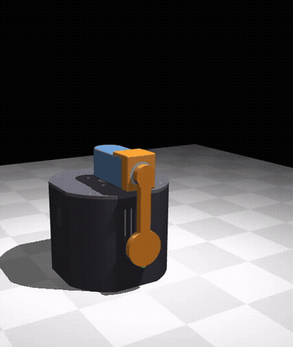
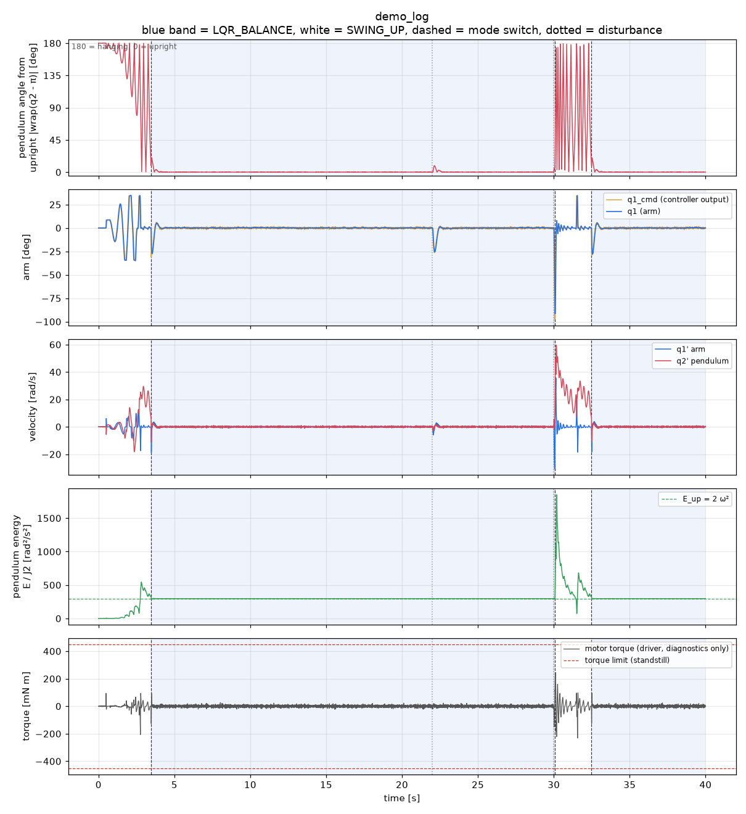
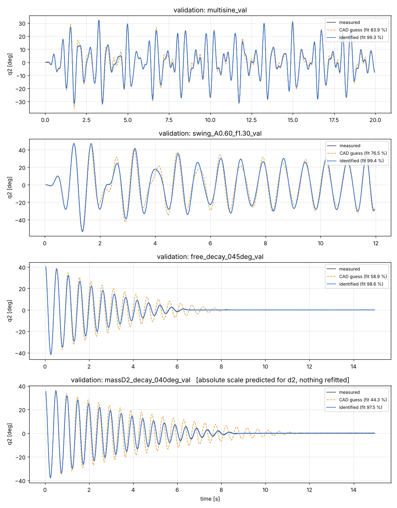

# RZ42: a ZDT-42 stepper Furuta pendulum, from CAD to identified model

A rotary inverted pendulum (Furuta pendulum) driven by a **ZDT 42×48 closed-loop stepper** (Y42 V2.0 driver board), with a 608ZZ pendulum bearing and an AS5600 magnetic encoder. It is designed to be 3D-printed with M3×5×4 heat inserts.

The repository covers the whole chain:

1. **CAD**: printable parts plus the bought parts, as STEP files.
2. **MuJoCo model**: the CAD assembly with a mass model for 15 % infill prints and a coin in the pendulum.
3. **Equations of motion**: derived with Kane's method in SymPy.
4. **Parameter identification**: from encoder logs only (no torque), tested on a hidden "real" plant and ready to repeat on hardware.
5. **Control**: energy-based swing-up and LQR balancing, both commanding only the **stepper's arm position** `q1_cmd`, with automatic switching. Validated in MuJoCo on the hidden plant.

> **Credit.** This project is based on, and inspired by, **[rotary-inverted-pendulum](https://github.com/ferrolho/rotary-inverted-pendulum) by Henrique Ferrolho** (MIT License): a £20 DIY rotary inverted pendulum with an RL controller.
>
> Taken or adapted from it:
> * the overall rig concept and joint conventions (URDF zero = arm along −y, pendulum hinge along the arm);
> * the pendulum-bearing friction values used as the initial guess (from its `policy/sysid_params_rig2.json`);
> * the idea of measuring the rig and fitting a simulator to it.
>
> The stepper-based mechanical redesign, the MuJoCo model of it, the Kane derivation and the identification here are new work. Please also cite and star the original project. See [`NOTICE.md`](NOTICE.md).

## Repository layout

| Folder | What is in it |
|---|---|
| [`cad/`](cad) | `step/`: all parts as STEP AP214 (open and edit in SolidWorks, Fusion, FreeCAD). `generator/`: the OpenCASCADE C++ source that builds them. |
| [`mujoco/`](mujoco) | `rz42_pendulum.xml`: the nominal (CAD) model. `rz42_real_plant.xml`: the hidden "real rig" used for the identification test. Also the experiment scripts, meshes and sine-test results. |
| [`dataset/`](dataset) | Encoder-only experiment logs (`t, arm_cmd, q1_meas, q2_meas`), the bench measurements taken on the assembled rig, and the hidden ground truth (read only by notebook 03). |
| [`control/`](control) | Swing-up, LQR, hybrid switching, ZDT position-servo model, MuJoCo closed-loop runner and viewer, validation tests, `config.json`. See [`docs/CONTROL_REPORT.md`](docs/CONTROL_REPORT.md). |
| [`results/`](results) | Demo log, plots, video and validation summary of the controller. |
| [`docs/`](docs) | [`DYNAMICS_AND_CONTROL.md`](docs/DYNAMICS_AND_CONTROL.md) (Kane's method → control → LQR, explained) and [`CONTROL_REPORT.md`](docs/CONTROL_REPORT.md) (controller design and validation). |
| [`identification/`](identification) | `01_kane_model.ipynb`: equations of motion with Kane's method. `02_parameter_identification.ipynb`: encoder-only identification, the one to use on the real rig. `03_evaluate_against_truth.ipynb`: scoring for the simulation study only. `EXPERIMENT_PROTOCOL.md`: the lab procedure. |

## Quick start (Windows PowerShell, Python 3.10–3.12)

```powershell
cd rz42-furuta-pendulum
python -m venv .venv
.\.venv\Scripts\python.exe -m pip install -r requirements.txt
.\.venv\Scripts\python.exe -m notebook identification
```

Then open a notebook and run all cells, in the order 01 → 02 → 03.
On Linux or macOS use `.venv/bin/python`.

To look at the model: `.\.venv\Scripts\python.exe -m mujoco.viewer --mjcf mujoco\rz42_pendulum.xml`

## Swing-up + LQR demo (position command only)



Full videos:
- [`results/demo_swingup_lqr.mp4`](results/demo_swingup_lqr.mp4): 40 s run with swing-up, LQR, tap, hard push and recovery;
- [`mujoco/results/`](mujoco/results): open-loop sine tests of the nominal model.

**How the model and the controller are derived** (Kane's method → state space → position-command model → LQR and swing-up) is explained step by step in [`docs/DYNAMICS_AND_CONTROL.md`](docs/DYNAMICS_AND_CONTROL.md).

```powershell
cd $HOME\Desktop\RZ42_furuta_pendulum
py -3.12 -m venv .venv
.\.venv\Scripts\python.exe -m pip install -r requirements.txt
.\.venv\Scripts\python.exe -m control.viewer      # live: swing-up -> LQR -> tap -> hard push -> recovery
.\.venv\Scripts\python.exe -m control.run_demo    # headless run, log and plots in results\
.\.venv\Scripts\python.exe -m control.validate    # automated tests
```

The run on the hidden plant:
- swings up and is caught at 3.5 s;
- balances for 26 s (0.12° RMS when undisturbed);
- rejects a tap;
- recovers through swing-up after a hard push.

Peak motor torque is 0.25 N·m, with no saturation. All validation tests pass, including the stepper servo being 8–25 Hz while the controller assumes 15 Hz. Details are in [`docs/CONTROL_REPORT.md`](docs/CONTROL_REPORT.md).



## The model

From `01_kane_model.ipynb`, in standard form $M(q)\ddot q + C(q,\dot q)\dot q + G(q) + F(\dot q) = \tau$, with $q = [q_1\ \text{arm},\ q_2\ \text{pendulum}]$, $q_2 = 0$ hanging and $\tau = [T, 0]$:

$$M=\begin{bmatrix} J_0 + J_1\sin^2 q_2 & K\cos q_2\\ K\cos q_2 & J_2\end{bmatrix},\quad
C\dot q=\begin{bmatrix}2J_1 \sin q_2\cos q_2\,\dot q_1\dot q_2 - K\sin q_2\,\dot q_2^2\\ -J_1\sin q_2\cos q_2\,\dot q_1^2\end{bmatrix},\quad
G=\begin{bmatrix}0\\ G\sin q_2\end{bmatrix},\quad
F=\begin{bmatrix} b_a\dot q_1 + F_a\tanh(\dot q_1/v_s)\\ b_p\dot q_2 + F_p\tanh(\dot q_2/v_s)\end{bmatrix}$$

The 14 physical unknowns (masses, centres of mass, inertias, friction) enter only through **9 lumped parameters**:

$$J_0 = J_a + m_a x_a^2 + m_p(r+c_p)^2 + I_{pz},\quad J_1 = I_{py}-I_{pz}+m_p l_p^2,\quad J_2 = I_{px}+m_p l_p^2,\quad K = I_{pxz}+m_p l_p(r+c_p),\quad G = g\,m_p l_p,$$

plus the four friction terms $b_a, F_a, b_p, F_p$.

## Parameter identification (encoders only, no torque)

The procedure is designed for the **physical rig**:
- It uses only the arm (stepper) encoder, the AS5600, loop timestamps and the arm commands. A stepper driver cannot measure torque reliably, so **torque is never used**.
- The rig stays fully assembled.
- The step-by-step lab procedure is in [`identification/EXPERIMENT_PROTOCOL.md`](identification/EXPERIMENT_PROTOCOL.md).

**What is identified.** The stepper is position-controlled, so the measured arm motion is the input. Only the pendulum row of the equations matters:

$$\ddot q_2 = -\kappa\cos q_2\,\ddot q_1 + \rho\,\sin q_2\cos q_2\,\dot q_1^2 - \omega^2\sin q_2 - \beta\,\dot q_2 - \phi\tanh(\dot q_2/v_s)$$

| Ratio | Meaning | Experiments that identify it |
|---|---|---|
| $\omega^2 = G/J_2$ | gravity stiffness | free decays, arm held |
| $\beta = b_p/J_2$, $\phi = F_p/J_2$ | 608ZZ viscous and Coulomb friction | free decays from 10–150° |
| $\kappa = K/J_2$ | how arm acceleration pushes the pendulum: the control input gain | arm sines, chirp |
| $\rho = J_1/J_2$ | centrifugal effect of arm speed | large arm swings, resonant pumping (pendulum to about 120°) |

These five ratios are the complete model a balancing and swing-up controller needs, since it commands the arm's acceleration.

The **absolute scale** ($J_2$, $G$, $K$, $J_1$, $b_p$, $F_p$ in SI units) comes from free decays with a **known ~10 g mass taped to the pendulum**. With a pre-assembly weighing of the pendulum it also gives the **pendulum centre of mass**.

**Not identifiable without torque**, and stated as such, not filled in from the simulation:
- the arm inertia $J_0$ and the arm friction;
- the arm's mass and centre of mass;
- $m_p$ and $l_p$ separately (without weighing);
- $I_{py}$ and $I_{pz}$ separately;
- $c_p$ and $I_{pxz}$ separately.

A position-commanded stepper controller needs none of them.

**Method** (`identification/02_parameter_identification.ipynb`):
1. Resample onto a uniform grid using the logged timestamps.
2. Calibrate the AS5600 zero from a rest recording.
3. Take Savitzky–Golay derivatives.
4. Linear least squares for a first estimate.
5. **Output-error fit**: simulate the pendulum driven by the measured arm motion, starting from the CAD guess.
6. Repeatability check on two disjoint groups of experiments.
7. Added-mass scale, with Monte-Carlo propagation of the scale and caliper errors.
8. Validation, then export of the upright model for the controller.

**Simulation study.** The hidden MuJoCo plant `mujoco/rz42_real_plant.xml` is used only to produce the encoder logs. The identification never reads it, the ground truth, or any simulated torque. Scoring is done separately in `03_evaluate_against_truth.ipynb`:

| | κ | ρ | ω² | β | φ | J2 (added mass) | l_p |
|---|---|---|---|---|---|---|---|
| CAD guess error | +2.7 % | −0.1 % | +3.3 % | −22 % | −23 % | −13.9 % | 42.77 mm |
| **Identified error** | **+0.07 %** | **−0.9 %** | **−0.14 %** | **−0.02 %** | **+0.5 %** | **−0.04 %** | **45.77 ± 0.29 mm** (truth 45.80) |

The ±1σ values from the fit's Jacobian are optimistic. On real data, use the **repeatability spread**: 0.2–1 %, and about 1 % for ρ and φ.

**Validation** on independent runs, simulated from start to end (CAD guess → identified):
- multisine: 83.9 % → **99.3 %**;
- large swing: 76.5 % → **99.4 %**;
- free decay from 45°: 58.9 % → **98.6 %**;
- added mass moved to d2: 44.3 % → **97.5 %**. Its frequency was predicted within **0.12 %** without refitting.



What the simulation cannot reproduce, and the real rig will add:
- stepper microstep ripple and missed steps;
- play in the D-shaft coupling;
- AS5600 cable drag;
- magnet eccentricity.

The repeatability and validation checks in notebook 02 are how you will see those on hardware.

## Regenerating the dataset

```powershell
cd mujoco
..\.venv\Scripts\python.exe make_real_plant.py      # writes rz42_real_plant*.xml and dataset/ground_truth.json
..\.venv\Scripts\python.exe run_experiments.py      # writes dataset/experiments/*.csv
```

The committed dataset was produced with the equivalent C runner, `tools/mj_runner.c` (MuJoCo 3.3.7, Linux): `python run_experiments.py --runner ../tools/mj_runner`.

## Hardware summary

| Part | Notes |
|---|---|
| Motor | ZDT 42×48 closed-loop stepper with Y42 V2.0 driver board, D-shaft into the arm hub (set screw + heat insert) |
| Pendulum bearing | 608ZZ, in a separate bearing housing screwed onto the arm with M3 + heat inserts |
| Pendulum encoder | AS5600 on the arm, diametric magnet D6×2.5 in the pendulum journal |
| Power | 70×55×20 battery pack in the base; control board outside the base |
| Prints | PLA, 15 % infill, 2 perimeters; all threads are M3×5×4 heat inserts |

## License

MIT, see [`LICENSE`](LICENSE). This project builds on Henrique Ferrolho's MIT-licensed [rotary-inverted-pendulum](https://github.com/ferrolho/rotary-inverted-pendulum); his copyright notice is kept in [`NOTICE.md`](NOTICE.md).
